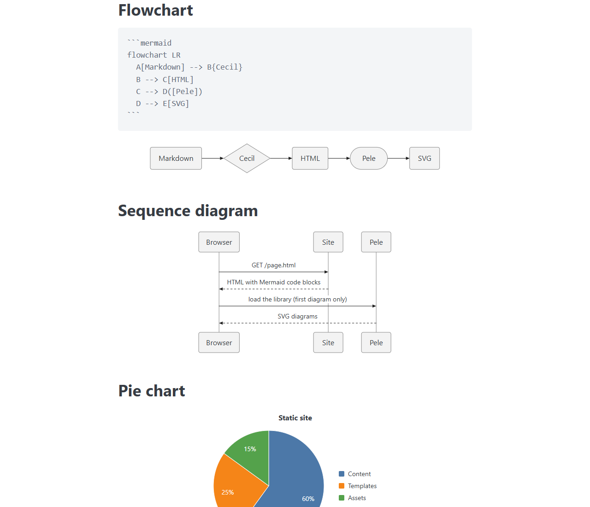
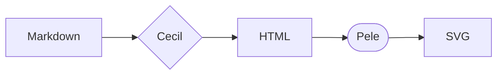

# Pele theme

The _Pele_ component theme for [Cecil](https://cecil.app) renders the [Mermaid](https://mermaid.js.org) diagrams of your pages to SVG with [Pele](https://pele.run), a small and fast Mermaid renderer, without any dependency.

**[Demo](https://cecilapp.github.io/theme-pele/)**



## Features

- Renders the ` ```mermaid ` code blocks (and `<pre class="mermaid">` elements) of your pages, with every diagram type of Mermaid 12
- Loaded only on pages containing a diagram (detected at build time), and the library is fetched on first use only
- The library is downloaded at build time and served from your site (or loaded from jsDelivr)
- Follows the color scheme of the page (`data-theme="dark"` or `dark` class on `<html>`, or the system preference) without re-rendering the diagrams, and works with the [_Dark mode toggle_](https://github.com/Cecilapp/theme-darkmodetoggle) theme
- Colors and fonts customizable with CSS custom properties
- Responsive (adapts the layout to the container width) and zoomable
- Without JavaScript, the Mermaid source stays displayed as a code block

## Installation

> [!NOTE]
> Requires Cecil 9.18 or later.

```bash
composer require cecil/theme-pele
```

> Or [download the latest archive](https://github.com/Cecilapp/theme-pele/releases/latest/) and uncompress its content in `themes/pele`.

## Usage

Add `pele` in the `theme` section of your `config.yml`:

```yaml
theme:
  - pele
```

Then include the partial in the `<head>` of your base layout:

```twig
{{ include('partials/pele.html.twig', {page, site}, with_context = false) }}
```

And write diagrams in your pages:

````markdown

````

> [!TIP]
> In a theme that should work with or without _Pele_, add `ignore_missing = true` to the `include()`.

### Front matter

The diagrams are detected in the page content at build time. Set `pele` in the front matter to force the loading (e.g. diagrams added by a script) or to disable it:

```yaml
---
pele: true # or false
---
```

### Configuration

Default options:

```yaml
pele:
  enabled: true # render the Mermaid diagrams
  version: '1.6.0' # Pele library version, loaded from jsDelivr
  #library: '' # URL of the Pele library (overrides `version`)
  local: true # download the library at build time and serve it from the site (false to load it from jsDelivr)
  auto: true # only on pages containing a diagram, detected at build time (false: on every page)
  selector: 'pre > code.language-mermaid, pre.mermaid' # elements holding the Mermaid source
  zoom: auto # auto (when the diagram is shrunk to fit), true (always), false, or Pele zoom options (`maxScale`, `controls`…)
  style: true # default dark colors and diagram container style (false to style it yourself)
  dark: auto # auto (`data-theme="dark"` or `dark` class on `<html>`, or system preference), attribute (only the attribute or class) or false
  options: {} # Pele `mount()` options (`fontSize`, `autoDirection`, `directionBreakpoint`, `links`, `config`…)
```

`options` are passed to [Pele `mount()`](https://pele.run/api), for example:

```yaml
pele:
  options:
    fontSize: 14
    autoDirection: false # keep the direction of the flowcharts on small screens
    config: # Mermaid configuration (frontmatter and directives of a diagram override it)
      flowchart:
        curve: linear
```

> [!IMPORTANT]
> If your site supports a light theme only, set `dark: attribute` (or `false`): otherwise the diagrams turn dark when the system prefers it.

### Styling

Each diagram is rendered in a `div.pele-diagram`. Colors and fonts are set with [Pele CSS custom properties](https://pele.run/theming), on the diagrams or any parent element (they take precedence over the theme defaults), for example to use the colors of your site:

```css
:root {
  --pele-bg: var(--background-color);
  --pele-fg: var(--text-color);
  --pele-accent: var(--primary-color);
  --pele-font: var(--font-family);
  --pele-radius: 6px;
  --pele-margin: 1.5rem; /* space below a diagram (theme) */
}
[data-theme="dark"] {
  --pele-bg: #000;
}
```

Other variables: `--pele-muted`, `--pele-line`, `--pele-surface`, `--pele-surface-alt`, `--pele-border`, `--pele-critical`, `--pele-error`, `--pele-font-mono`, `--pele-series-1` to `--pele-series-8` (charts), `--pele-zoom-top|right|bottom|left` (zoom controls position).

### JavaScript

Diagrams added to the page after its loading can be rendered with `window.cecilPele.mount(root)`, which returns a promise of the [`Mounted`](https://pele.run/api) diagrams. A `pele:mount` event is dispatched on each diagram:

```js
document.addEventListener('pele:mount', (event) => {
  console.log(event.target, event.detail.mounted, event.detail.source);
});
```

### Internationalization

The labels of the zoom controls are translatable (English and French are provided). Add your translations in `translations/messages.<locale>.yml`:

```yaml
"Zoom in": "Zoom avant"
"Zoom out": "Zoom arrière"
"Reset zoom": "Réinitialiser le zoom"
```

## Development

Run the demo site with the theme under development:

```bash
php demo/link.php
php cecil.phar serve demo
```

## License

_Pele_ theme is a free software distributed under the terms of the MIT license.

[Pele](https://github.com/obsidianmd/pele) © Obsidian, MIT license.
