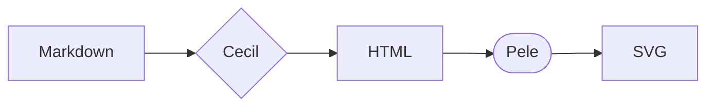
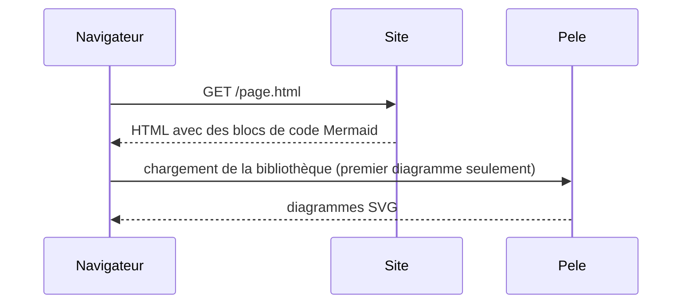
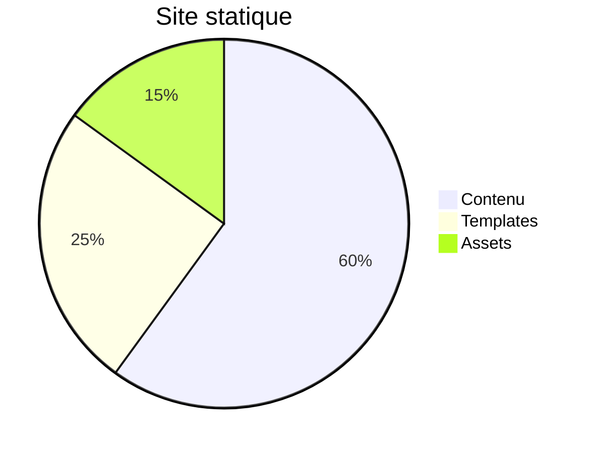

# Pele pour Cecil

Ce site est la démo du [thème composant _Pele_](https://github.com/Cecilapp/theme-pele) pour [Cecil](https://cecil.app) : les blocs de code Mermaid des pages sont rendus en SVG par [Pele](https://pele.run), un moteur de rendu Mermaid léger et rapide.

Changez le thème de couleurs dans l'en-tête : les diagrammes le suivent, sans être redessinés.

## Organigramme

## Diagramme de séquence

## Camembert

