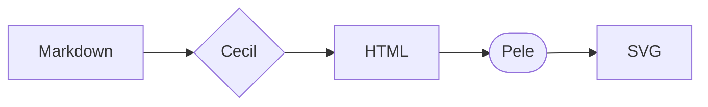
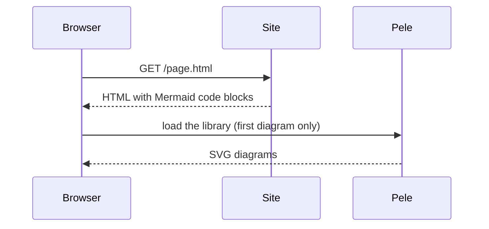
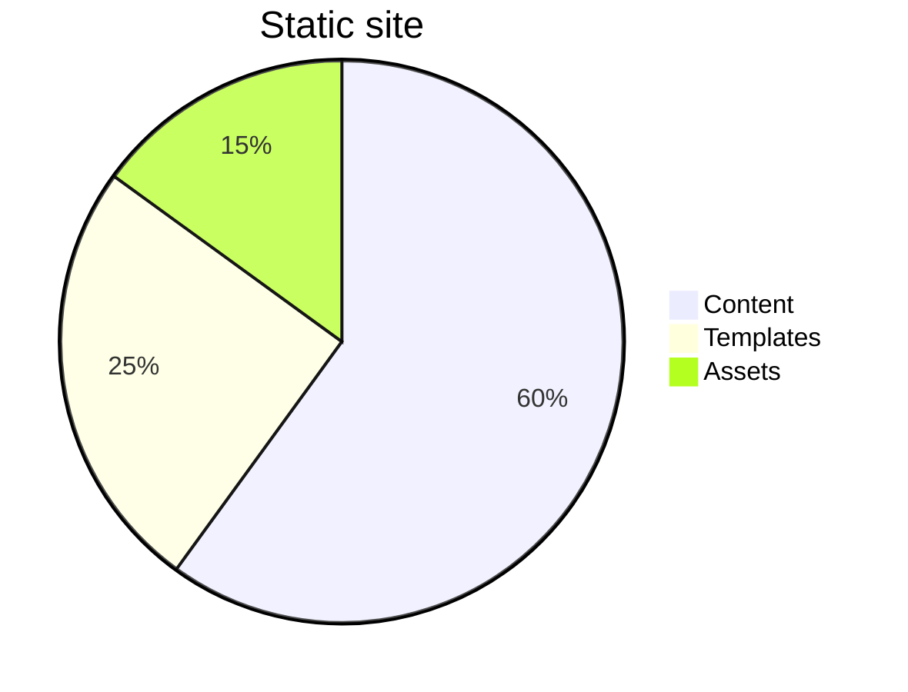
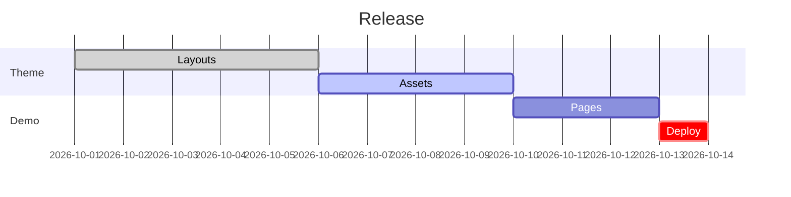

# Pele for Cecil

This website is the demo of the [_Pele_ component theme](https://github.com/Cecilapp/theme-pele) for [Cecil](https://cecil.app): the Mermaid code blocks of the pages are rendered to SVG by [Pele](https://pele.run), a small and fast Mermaid renderer.

Switch the color scheme in the header: the diagrams follow it, without being re-rendered.

## Flowchart

````markdown

````



## Sequence diagram



## Pie chart



## Gantt chart



## Error

A diagram with a syntax error is displayed with its error message:

```mermaid
flowchart LR
  A --> 
```
